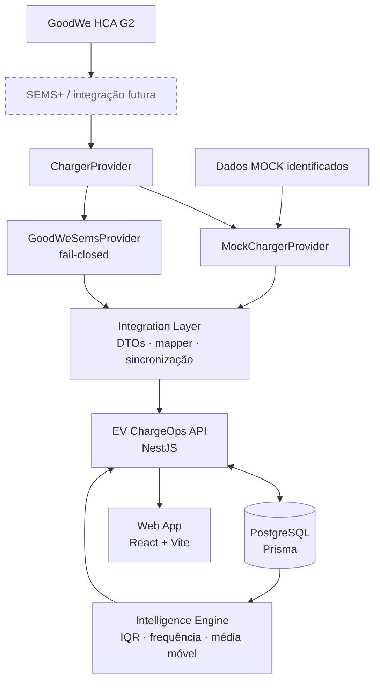
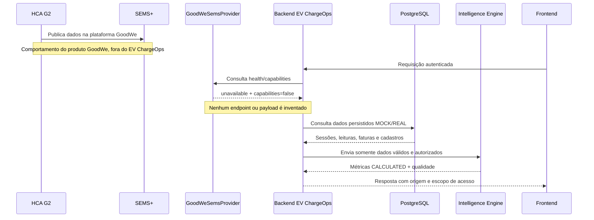
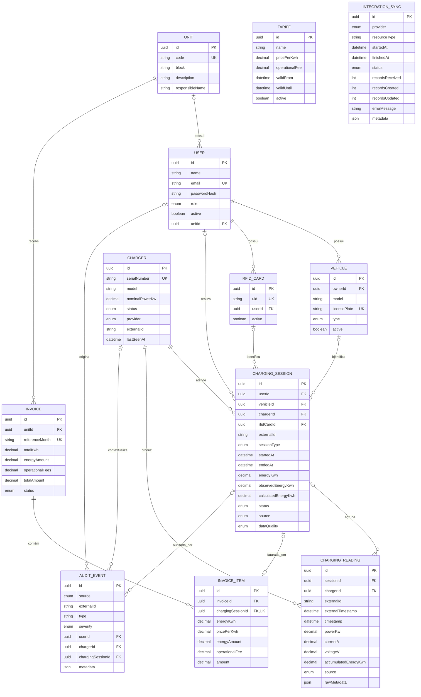
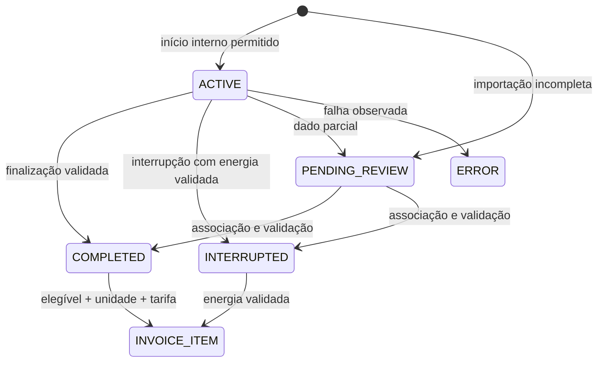

# EV ChargeOps

## Enterprise Challenge 2026 — GoodWe + FIAP

## Visão Geral

O EV ChargeOps é um protótipo funcional para gestão de recarga compartilhada de veículos elétricos. O monorepo reúne uma API NestJS, uma aplicação web React, persistência PostgreSQL com Prisma, autenticação JWT, rateio por sessão, faturamento, analytics explicável e um modo de demonstração offline.

O software não envia comandos para carregadores GoodWe. A fronteira de integração SEMS+ existe, mas permanece bloqueada de forma segura enquanto não houver contrato oficial de API, credenciais de OpenAPI autorizadas e schemas confirmados para o HCA G2.

## Problema

Condomínios e organizações que compartilham carregadores precisam saber quem carregou, quanto consumiu, qual equipamento foi utilizado e quanto deve ser atribuído a cada unidade. Sem rastreabilidade, sessões sem identificação, dados incompletos e tarifas aplicadas fora do período tornam o rateio difícil de auditar.

O EV ChargeOps organiza esse fluxo sem transformar telemetria externa em verdade automática: cada sessão conserva fonte, qualidade, energia observada ou calculada e estado de revisão.

## Solução

- centralizar carregadores, sessões, usuários, unidades, veículos e cartões RFID;
- separar dados reais, simulados e calculados;
- consolidar consumo e cobrança por unidade;
- impedir faturamento automático de sessões sem qualidade válida;
- apresentar indicadores operacionais explicáveis;
- responder perguntas gerenciais com fontes rastreáveis;
- continuar demonstrável sem internet ou acesso à GoodWe.

## Público-alvo

- administradores da plataforma;
- síndicos e gestores de unidades ou organizações;
- moradores e usuários de carregadores compartilhados;
- equipes técnicas responsáveis pela operação e integração dos carregadores.

## Funcionalidades

- autenticação JWT e perfis `ADMIN`, `MANAGER` e `USER`;
- gestão persistente de usuários, unidades, veículos e cartões RFID pela API;
- carregadores e telemetria operacional via provider MOCK;
- sessões internas e importadas, qualidade de dados e revisão manual;
- rateio e faturamento mensal por unidade;
- dashboard conectado à API para gestores e usuários;
- inteligência explicável com padrões, picos, ociosidade, IQR, evolução mensal e previsão;
- Síndico Virtual determinístico com contexto agregado e fontes;
- modo DEMO offline com origem explícita;
- infraestrutura GoodWe fail-closed, sem chamadas especulativas.

## Arquitetura



O caminho por SEMS+ representa a fronteira prevista para a integração futura. No estado atual do código, o conector GoodWe não realiza chamadas e não existe cliente Modbus. O fluxo executável usa o `MockChargerProvider` ou o provider híbrido de demonstração, que recorre a MOCK quando nenhuma capability real está disponível.

Tecnologias principais:

- React 19, TypeScript, Vite, React Router, TanStack Query, React Hook Form, Zod, Tailwind CSS e Recharts;
- NestJS 11, Swagger, Passport JWT, class-validator e Helmet;
- PostgreSQL 17, Prisma 6 e campos `Decimal` para energia e valores monetários;
- pnpm workspaces;
- Jest, Supertest e Vitest;
- Docker Compose, imagens Node e Nginx.

## Fluxo dos dados

O diagrama abaixo mostra o comportamento implementado atualmente. A comunicação física HCA G2 → SEMS pertence à plataforma GoodWe; a aplicação ainda não lê esses dados por API.



Na sincronização de carregadores, o provider produz DTOs externos; o serviço valida a origem, converte o snapshot para o modelo Prisma e usa chaves externas e timestamps para evitar duplicação. Atualmente esse fluxo pode ser exercitado integralmente apenas com o provider MOCK.

## GoodWe HCA G2

As características abaixo foram verificadas na documentação oficial consultada durante a descoberta técnica:

- versões nominais de 7 kW, 11 kW e 22 kW;
- operação por aplicativo;
- autenticação por cartão RFID;
- modo Auto Start;
- comunicação Bluetooth;
- comunicação Wi-Fi;
- interface RS485;
- interface LAN;
- suporte a Modbus TCP.

Os modelos representados no domínio e nos dados fictícios são `GW7K-HCA-20`, `GW11K-HCA-20` e `GW22K-HCA-20`. Isso não significa que equipamentos reais desses modelos tenham sido encontrados na conta SEMS+ do projeto.

## Integração GoodWe

### Implementado

- contrato interno `ChargerProvider`;
- `MockChargerProvider` funcional;
- `DemoHybridChargerProvider` com fallback offline identificado;
- `GoodWeSemsProvider` fail-closed;
- abstrações `GoodWeAuthClient`, `GoodWeApiClient`, `GoodWeHttpClient`, parser e mapper;
- timeout, classificação de `401`, `403`, `429`, `5xx`, timeout e payload inválido na infraestrutura HTTP;
- retry limitado apenas para falhas transitórias;
- logs e erros sem credenciais completas;
- health check e capability detection;
- sincronização idempotente de cadastro e telemetria quando o provider oferece esses dados;
- testes com fixtures sintéticas e sanitizadas, sem conta real.

### Preparado

- DTOs externos separados do modelo de domínio;
- capabilities explícitas para carregadores, status, telemetria, sessões, eventos, RFID, alarmes e controle;
- persistência idempotente por identificador externo e timestamp;
- página `/integracoes/goodwe` conectada ao health do provider;
- exibição de provider, READ-ONLY, capabilities, sincronização, erro sanitizado e dispositivos identificados;
- modo híbrido que mantém dispositivos REAL e MOCK separados.

### Dependente da OpenAPI oficial

- autenticação real na Open API;
- listagem real de estações ou dispositivos;
- confirmação do HCA G2 na conta fornecida;
- telemetria, sessões, RFID, alarmes ou histórico reais;
- tensão como campo confirmado da API;
- endpoints `/api/integrations/goodwe/*` — eles não existem no código atual;
- envio de comandos ou controle remoto;
- cliente Modbus TCP.

Quando `CHARGER_PROVIDER=goodwe`, a aplicação inicia, mas o provider informa `unavailable` e suas operações de dados lançam `ProviderCapabilityNotSupportedError`.

Para habilitar dados reais são necessários, no mínimo:

1. confirmação de conta organizacional e licença Open API;
2. base URL e região oficiais;
3. fluxo de autenticação e escopos documentados;
4. endpoints READ-ONLY específicos para `EV Charger`/HCA G2;
5. schemas, unidades, enums, paginação, limites e timezone;
6. rodada mínima de testes autorizados com respostas sanitizadas.

O relatório completo está em [`docs/goodwe-integration-discovery.md`](docs/goodwe-integration-discovery.md). Credenciais, tokens e cookies não devem ser incluídos em código, documentação, fixtures ou logs.

## Dados REAL, MOCK e CALCULATED

Toda resposta operacional relevante usa uma destas origens:

| Origem       | Significado                                                                                                                                                     |
| ------------ | --------------------------------------------------------------------------------------------------------------------------------------------------------------- |
| `REAL`       | Dado observado por uma fonte externa não simulada, como SEMS ou Modbus. A infraestrutura aceita essa origem, mas o projeto ainda não obteve dados reais GoodWe. |
| `MOCK`       | Dado fictício gerado por provider, seed ou modo de demonstração.                                                                                                |
| `CALCULATED` | Indicador derivado pelo EV ChargeOps, como total, rateio, utilização, anomalia ou previsão.                                                                     |

Valores indisponíveis são retornados como ausentes ou apresentados como “Não disponibilizado pela integração atual”; não são preenchidos silenciosamente com zero. No modo híbrido, um dado MOCK nunca é anexado a um identificador de carregador REAL para esconder uma capability ausente.

## Modelo de dados

O diagrama corresponde às entidades e relações presentes em `apps/api/prisma/schema.prisma`.



`Tariff` e `IntegrationSync` não possuem relação Prisma direta com outras entidades: a tarifa aplicável é localizada por período durante a geração, e cada sincronização registra seu próprio resumo.

## Sessões

O domínio diferencia:

- `INTERNAL`: iniciada no EV ChargeOps quando o provider permite `startSession`;
- `IMPORTED`: proveniente de integração externa e permitida sem usuário ou veículo inicialmente.

Sessões importadas incompletas permanecem `PENDING_REVIEW`. O modelo separa energia observada (`observedEnergyKwh`) de energia calculada (`calculatedEnergyKwh`) e registra `dataQuality` como `VALID`, `PARTIAL` ou `INVALID`.

É possível listar, consultar, iniciar e finalizar sessões internas, além de associar usuário, veículo e RFID. Associações manuais geram `AuditEvent`. A finalização de uma sessão importada pela API é rejeitada; ela deve vir da fonte externa. O início real em GoodWe não está disponível.

## Fluxo de uma sessão



O estado da sessão não é inferido silenciosamente quando faltam identificação, término ou energia confiável. Apenas sessões elegíveis avançam para um item de fatura.

## Rateio

O rateio usa somente sessões:

- `COMPLETED` ou `INTERRUPTED`;
- com `dataQuality=VALID`;
- finalizadas;
- associadas a usuário que pertence a uma unidade;
- ainda não vinculadas a outro item de fatura.

Para sessões interrompidas, é usada somente a energia observada disponível. A fórmula implementada é:

```text
energyAmount = energyKwh × pricePerKwh
itemAmount = energyAmount + operationalFee
```

Os cálculos utilizam `Prisma.Decimal`, arredondamento monetário em duas casas e energia em três casas. Usuários e veículos da mesma unidade são consolidados na mesma fatura mensal.

## Faturamento

A geração cria ou atualiza uma fatura por `unitId + referenceMonth`. Cada `InvoiceItem` possui `chargingSessionId` único, evitando cobrança duplicada, e conserva snapshots de `energyKwh`, `pricePerKwh`, `energyAmount` e `operationalFee`.

Se não houver sessões elegíveis, a geração pode criar uma fatura aberta com totais zerados, sem cobrança variável. Faturas abertas podem ser fechadas; faturas fechadas ou pagas são retornadas de forma idempotente. Não há endpoint para marcar pagamento ou cancelar fatura.

## Inteligência

A inteligência faz parte da lógica do produto porque transforma histórico operacional em sinais úteis para capacidade, manutenção e gestão de custos. Ela não controla carregadores nem altera faturamento.

A implementação atual é estatística, determinística e explicável:

- **padrões de uso:** frequência de sessões por hora e dia da semana;
- **picos:** três horas não vazias com maior frequência;
- **ociosidade:** lacunas entre intervalos de ocupação e utilização por carregador;
- **detecção de anomalias:** IQR aplicado separadamente a energia e duração, com mínimo de oito sessões válidas;
- **previsão:** média móvel das últimas quatro semanas disponíveis, exigindo ao menos três semanas completas e cinco sessões;
- **qualidade:** indicadores `HIGH`, `MEDIUM`, `LOW` ou `INSUFFICIENT`, conforme amostra e estabilidade.

### Síndico Virtual

O **Síndico Virtual** não acessa o banco livremente. `IntelligenceContextService` prepara um contexto agregado e autorizado; o assistente determinístico reconhece um conjunto limitado de perguntas gerenciais e responde com `sources`. Não há integração com LLM no código atual, mesmo que `ASSISTANT_PROVIDER` apareça no arquivo de exemplo.

A metodologia completa está em [`docs/intelligence-methodology.md`](docs/intelligence-methodology.md).

## Dashboards

O frontend possui rotas para login, dashboard, carregadores, sessões, unidades, usuários, veículos, RFID, tarifas, faturas, inteligência, integração GoodWe e conta.

Conectadas à API atualmente:

- autenticação;
- resumo do dashboard;
- lista e visão operacional de carregadores;
- inteligência gerencial e consulta ao Síndico Virtual;
- estado do provider e sincronização na página GoodWe.

As demais páginas existem como interface navegável, mas várias ainda usam conjuntos locais de apresentação definidos em `apps/web/src/lib/portal-data.ts`. Elas não devem ser interpretadas como CRUD totalmente integrado ao backend. A tela de tarifas é apenas visual; não existe controller HTTP de tarifas.

A visão operacional do carregador mostra status, modelo, potência nominal, potência atual, energia, corrente, tensão, atualização e gráfico de leituras quando esses dados existem. Cada métrica é identificada como `REAL`, `MOCK`, `CALCULATED` ou indisponível.

## Segurança

Medidas implementadas:

- autenticação JWT Bearer;
- senhas armazenadas com hash bcrypt;
- perfis `ADMIN`, `MANAGER` e `USER`;
- guards globais de autenticação e papel;
- consultas com escopo por usuário ou unidade para reduzir IDOR;
- usuários inativos não autenticam;
- `passwordHash` não é selecionado nas respostas públicas;
- validação global com whitelist e rejeição de campos desconhecidos;
- Helmet e CORS configurável;
- limites e validação de UUIDs, datas, enums e payloads;
- logs da integração sem credenciais completas;
- integração GoodWe somente READ-ONLY e fail-closed.

O projeto não implementa refresh token, revogação de JWT, MFA, rate limiting HTTP global, criptografia de banco ou gestão externa de segredos.

## LGPD

O modelo contém dados potencialmente pessoais: nome, e-mail, placa, RFID, unidade e histórico de recarga. A implementação aplica isolamento por perfil e unidade, evita retornar hashes de senha e usa identidades fictícias nos seeds.

Isso não constitui, por si só, conformidade integral com a LGPD. Ainda não existem no produto fluxos de consentimento, exportação do titular, anonimização, exclusão, política de retenção, registro de base legal ou gestão formal de incidentes. Esses controles precisam ser definidos antes de uso produtivo.

## API

Todas as rotas usam o prefixo `/api`. Exceto health e login, exigem JWT. “Autenticado” significa qualquer perfil, com filtros adicionais aplicados pelos services.

| Método   | Endpoint                                    | Acesso         | Implementação atual                                        |
| -------- | ------------------------------------------- | -------------- | ---------------------------------------------------------- |
| `GET`    | `/api/health`                               | Público        | Retorna `{ "status": "ok" }`.                              |
| `POST`   | `/api/auth/login`                           | Público        | Autentica e emite JWT.                                     |
| `GET`    | `/api/auth/me`                              | Autenticado    | Retorna o usuário atual sem `passwordHash`.                |
| `GET`    | `/api/dashboard/summary`                    | Autenticado    | Resumo mensal com escopo por perfil.                       |
| `GET`    | `/api/chargers`                             | Autenticado    | Lista carregadores e origem.                               |
| `GET`    | `/api/chargers/:id/operational`             | Autenticado    | Métricas e leituras classificadas por origem.              |
| `GET`    | `/api/chargers/provider/health`             | Autenticado    | Estado e capabilities do provider ativo.                   |
| `POST`   | `/api/chargers/sync`                        | ADMIN, MANAGER | Sincroniza cadastro e telemetria oferecidos pelo provider. |
| `GET`    | `/api/charging-sessions`                    | Autenticado    | Lista sessões respeitando usuário/unidade e filtros.       |
| `GET`    | `/api/charging-sessions/:id`                | Autenticado    | Consulta sessão com proteção de acesso.                    |
| `POST`   | `/api/charging-sessions/start`              | Autenticado    | Inicia sessão somente se o provider permitir.              |
| `POST`   | `/api/charging-sessions/:id/finish`         | Autenticado    | Finaliza sessão interna acessível ao usuário.              |
| `POST`   | `/api/charging-sessions/:id/assign-user`    | ADMIN, MANAGER | Associação manual de usuário.                              |
| `POST`   | `/api/charging-sessions/:id/assign-vehicle` | Autenticado    | Associação com validação de propriedade/unidade.           |
| `POST`   | `/api/charging-sessions/:id/assign-rfid`    | Autenticado    | Associação com validação de propriedade/unidade.           |
| `GET`    | `/api/invoices`                             | Autenticado    | Lista faturas dentro do escopo permitido.                  |
| `GET`    | `/api/invoices/:id`                         | Autenticado    | Consulta fatura; USER recebe somente seus itens.           |
| `POST`   | `/api/invoices/generate`                    | ADMIN, MANAGER | Gera fatura idempotente por unidade e mês.                 |
| `POST`   | `/api/invoices/:id/close`                   | ADMIN, MANAGER | Fecha fatura aberta.                                       |
| `GET`    | `/api/intelligence/manager`                 | ADMIN, MANAGER | Analytics explicável para janela de 7 a 365 dias.          |
| `POST`   | `/api/assistant/query`                      | ADMIN, MANAGER | Síndico Virtual determinístico e rastreável.               |
| `GET`    | `/api/users`                                | Autenticado    | Lista usuários dentro do escopo.                           |
| `GET`    | `/api/users/:id`                            | Autenticado    | Consulta com proteção contra IDOR.                         |
| `POST`   | `/api/users`                                | ADMIN, MANAGER | Cria usuário conforme escopo do ator.                      |
| `PATCH`  | `/api/users/:id`                            | Autenticado    | Atualiza campos permitidos pelo perfil.                    |
| `DELETE` | `/api/users/:id`                            | ADMIN, MANAGER | Desativa usuário; não remove fisicamente.                  |
| `GET`    | `/api/units`                                | Autenticado    | Lista unidades visíveis.                                   |
| `GET`    | `/api/units/:id`                            | Autenticado    | Consulta unidade visível.                                  |
| `POST`   | `/api/units`                                | ADMIN          | Cria unidade.                                              |
| `PATCH`  | `/api/units/:id`                            | ADMIN, MANAGER | Atualiza unidade dentro do escopo.                         |
| `GET`    | `/api/vehicles`                             | Autenticado    | Lista veículos visíveis.                                   |
| `GET`    | `/api/vehicles/:id`                         | Autenticado    | Consulta veículo visível.                                  |
| `POST`   | `/api/vehicles`                             | Autenticado    | Cria veículo com validação do proprietário.                |
| `PATCH`  | `/api/vehicles/:id`                         | Autenticado    | Atualiza veículo visível.                                  |
| `DELETE` | `/api/vehicles/:id`                         | Autenticado    | Desativa veículo; não remove fisicamente.                  |
| `GET`    | `/api/rfid-cards`                           | Autenticado    | Lista cartões visíveis.                                    |
| `GET`    | `/api/rfid-cards/:id`                       | Autenticado    | Consulta cartão visível.                                   |
| `POST`   | `/api/rfid-cards`                           | ADMIN, MANAGER | Cria e vincula cartão a usuário.                           |
| `PATCH`  | `/api/rfid-cards/:id`                       | ADMIN, MANAGER | Atualiza cartão dentro do escopo.                          |
| `DELETE` | `/api/rfid-cards/:id`                       | ADMIN, MANAGER | Desativa cartão; não remove fisicamente.                   |

Não existem endpoints HTTP para CRUD de tarifas, auditoria, `IntegrationSync`, pagamento/cancelamento de faturas ou controle de carregadores.

## Swagger

Com a API em execução:

```text
http://localhost:3000/api/docs
```

O Swagger descreve controllers e autenticação Bearer. Os DTOs usam decorators de validação, mas a documentação não substitui a inspeção das regras de autorização aplicadas nos services.

## Estrutura do monorepo

```text
.
├── apps
│   ├── api
│   │   ├── prisma
│   │   ├── src
│   │   └── test
│   └── web
│       └── src
├── docs
│   ├── goodwe-integration-discovery.md
│   └── intelligence-methodology.md
├── packages
│   └── shared
├── docker-compose.yml
├── package.json
├── pnpm-lock.yaml
└── pnpm-workspace.yaml
```

- `apps/api`: API, domínio, providers, Prisma, seeds e testes Jest/Supertest;
- `apps/web`: SPA React, componentes, rotas e teste Vitest;
- `packages/shared`: tipos e contratos compartilhados;
- `docs`: descoberta GoodWe e metodologia de inteligência.

## Como executar

Pré-requisitos:

- Node.js 22 ou compatível;
- pnpm 10;
- Docker com Docker Compose.

No PowerShell:

```powershell
Copy-Item .env.example .env
docker compose up -d postgres
pnpm install
pnpm db:generate
pnpm --filter @ev-chargeops/api exec prisma db push
pnpm db:seed
pnpm dev
```

Antes do seed, defina no `.env` um `JWT_SECRET` com pelo menos 32 caracteres e um `SEED_ADMIN_PASSWORD` com pelo menos 12 caracteres.

Serviços locais:

- Web: `http://localhost:5173`
- API: `http://localhost:3000/api`
- Swagger: `http://localhost:3000/api/docs`

## Variáveis de ambiente

| Variável                | Uso real no código                                                                      |
| ----------------------- | --------------------------------------------------------------------------------------- |
| `NODE_ENV`              | Define o ambiente do processo e é configurada no container da API.                      |
| `PORT`                  | Porta da API; padrão `3000`.                                                            |
| `WEB_ORIGIN`            | Origens CORS, separadas por vírgula.                                                    |
| `DATABASE_URL`          | Conexão PostgreSQL usada pelo Prisma.                                                   |
| `JWT_SECRET`            | Obrigatória, mínimo de 32 caracteres.                                                   |
| `JWT_EXPIRES_IN`        | Presente no exemplo, mas não é consumida atualmente; o JWT usa duração fixa de 8 horas. |
| `SEED_ADMIN_PASSWORD`   | Senha local do administrador criado pelo seed; mínimo de 12 caracteres.                 |
| `VITE_ENABLE_DEMO`      | Exibe o botão de demonstração local no login.                                           |
| `DEMO_MODE`             | Seleciona o provider híbrido quando `true`.                                             |
| `CHARGER_PROVIDER`      | Seleciona `mock` ou `goodwe` fora do modo DEMO.                                         |
| `GOODWE_SEMS_USERNAME`  | Reservada; não é lida pelo provider enquanto o contrato Open API não for confirmado.    |
| `GOODWE_SEMS_PASSWORD`  | Reservada; não é lida pelo provider enquanto o contrato Open API não for confirmado.    |
| `GOODWE_READ_ONLY`      | Declara a intenção de operação READ-ONLY, mas não altera comportamento no código atual. |
| `INTELLIGENCE_TIMEZONE` | Timezone dos agrupamentos; padrão `America/Sao_Paulo`, com fallback UTC.                |
| `ASSISTANT_PROVIDER`    | Reservada; o assistente atual é sempre determinístico.                                  |

`.env.example` contém apenas valores fictícios ou vazios. Nunca versione o `.env` real.

## Docker

Para subir PostgreSQL, API e Web:

```powershell
$env:JWT_SECRET = 'substitua-por-um-segredo-local-com-32-caracteres'
docker compose up --build
```

A aplicação fica em `http://localhost:8080`. O Nginx entrega a SPA e encaminha `/api` para o container da API. Na inicialização, a API executa `prisma db push`; o Compose não executa seeds automaticamente.

## Seed

Seed base:

```powershell
pnpm db:seed
```

Ele cria dados fictícios e idempotentes: administrador local, três unidades DEMO, cinco usuários no total, veículos BEV/PHEV, RFIDs, três HCA G2 simulados, tarifa, sessões, leitura, fatura, sincronização e auditoria. A única senha configurável é a do administrador, fornecida localmente por `SEED_ADMIN_PASSWORD`.

Histórico de demonstração:

```powershell
pnpm demo:seed
```

Esse comando executa o seed base e gera três meses de histórico, com 12 sessões MOCK por mês, três leituras por sessão e faturas fictícias. As operações usam upsert/chaves externas para permitir repetição sem duplicar sessões e leituras.

O seed base e os scripts DEMO exigem `DEMO_MODE=true` e recusam execução quando `NODE_ENV=production`.

Para remover dados DEMO/MOCK e preservar registros GoodWe/REAL:

```powershell
pnpm demo:reset
```

## Testes

Comandos disponíveis:

```powershell
pnpm lint
pnpm typecheck
pnpm test
pnpm build
pnpm --filter @ev-chargeops/api test:e2e
```

A suíte cobre tipos compartilhados, smoke test do frontend, providers, parser, mapper, cliente HTTP, erros, timeout, rate limit, payloads parciais, sincronização, idempotência, sessões, faturamento, inteligência, assistente e autorização. Os testes GoodWe usam somente fixtures sintéticas sanitizadas; nenhuma credencial ou conta real é utilizada.

## Modo Demo

Ative no `.env`:

```dotenv
DEMO_MODE=true
```

O provider híbrido consulta primeiro o health da GoodWe. Como o provider real está atualmente indisponível, o modo continua operacional com carregadores e telemetria MOCK identificados. Caso capabilities reais sejam implementadas futuramente, dispositivos reais e simulados permanecerão separados por identificador e origem.

Há também um modo visual no navegador, habilitado por `VITE_ENABLE_DEMO=true`, acessível pelo botão **Explorar demonstração**. Ele usa dados locais e não autentica na API.

## Decisões arquiteturais

As decisões sobre provider, fail-closed, READ-ONLY, ambiente MOCK e origem dos dados estão registradas em [`docs/architecture-decisions.md`](docs/architecture-decisions.md).

A matriz de aderência ao desafio está em [`docs/challenge-compliance.md`](docs/challenge-compliance.md), e o roteiro detalhado de cinco minutos está em [`docs/demo-script.md`](docs/demo-script.md).

## Limitações

- integração real SEMS+ não habilitada;
- nenhum cliente Modbus TCP;
- nenhuma ação de controle remoto;
- estações e HCA G2 reais da conta não foram observados;
- sincronização atual cobre carregadores e telemetria, não importa sessões ou eventos externos;
- várias telas do frontend ainda usam dados locais de apresentação;
- tarifas têm modelo Prisma e seed, mas não têm API CRUD;
- Síndico Virtual usa templates determinísticos e intenções limitadas, sem LLM;
- previsão é um baseline de média móvel, não um modelo causal;
- ausência de refresh token, MFA, rate limiting global e ciclo LGPD completo;
- não há reservas, notificações, aplicativo móvel ou suporte multi-organização explícito;
- o Docker usa `prisma db push`; não há histórico versionado de migrations no repositório.

## Roadmap

Possíveis evoluções, ainda não implementadas:

- maior integração SEMS;
- Modbus TCP direto;
- reservas;
- notificações;
- precificação por horário;
- previsão avançada;
- múltiplos condomínios;
- aplicativo móvel;
- protocolos adicionais em equipamentos futuros.

## Roteiro de demonstração

Roteiro sugerido de cinco minutos usando `DEMO_MODE=true` e `pnpm demo:seed`:

1. **Login:** entrar com o administrador criado pelo seed ou usar **Explorar demonstração**, explicando que o segundo caminho é somente visual.
2. **Dashboard:** mostrar energia, sessões, disponibilidade e origem `CALCULATED` dos indicadores.
3. **Integração GoodWe:** abrir a tela de integração e explicar que o provider real está fail-closed, sem chamadas especulativas; consultar o health pela API se necessário.
4. **HCA G2:** abrir um carregador simulado e mostrar status, potência, energia, corrente, tensão, atualização e origem `MOCK`.
5. **Sessão:** apresentar estados, qualidade, energia observada/calculada e possibilidade de revisão/associação pela API.
6. **Rateio:** explicar a seleção de sessões válidas e as fórmulas de energia e taxa operacional.
7. **Fatura:** mostrar consolidação por unidade, snapshots de tarifa e proteção contra duplicidade.
8. **Inteligência:** apresentar picos, padrões, ociosidade, IQR e previsão por média móvel, destacando qualidade da amostra.
9. **Síndico Virtual:** perguntar “Qual horário tem maior demanda?” e conferir as métricas listadas em `sources`.

As páginas que usam dados locais devem ser apresentadas como protótipo visual, não como prova de persistência pela API.

## Autores

- Nome: ______________________________ — RM: __________________
- Nome: ______________________________ — RM: __________________
- Nome: ______________________________ — RM: __________________
- Nome: ______________________________ — RM: __________________
